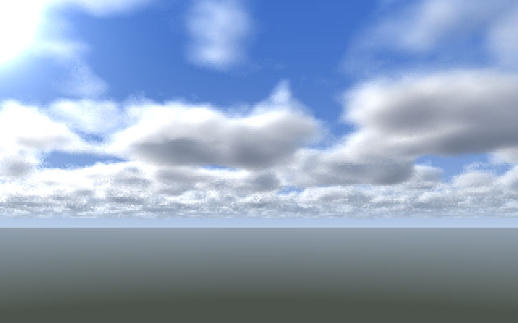
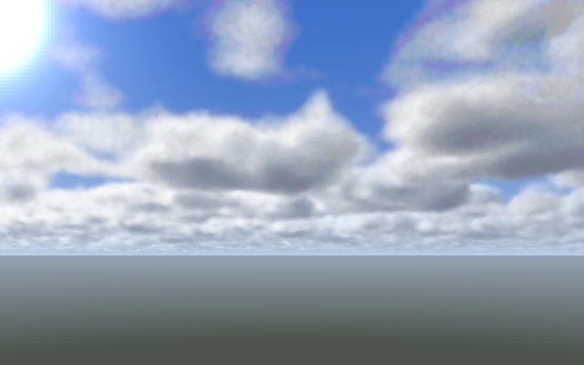
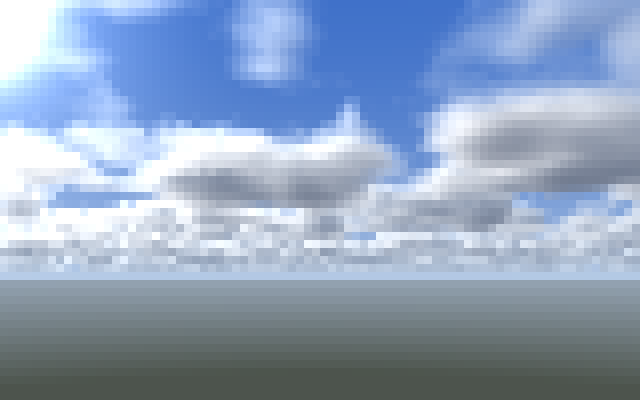
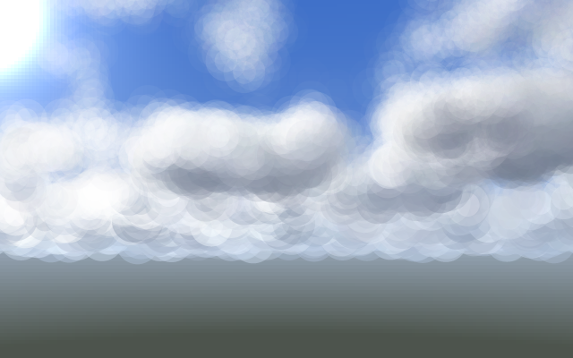
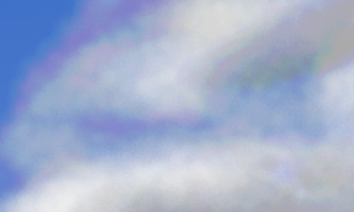

# Spike: ray marching vs. splatting clouds in pscat (#1)

**Question** (from #1's open questions): can the CPU interpreter march a ray
per pixel through a 3D density field in a usable time, or do clouds have to be
built from layers of translucent shapes?

**Answer: ray marching.** Per-pixel marching gives the better image for the
same time, scales linearly with pixel count, and avoids an 8-bit compositing
artifact that splats run into. Splats are still useful as a 1-second preview
for composition.

Measured with pscat 0.6.2 on an Apple-silicon Mac (macOS 15), single
thread, `usertime` cross-checked against `/usr/bin/time`. Seed 7. Both
renderers are deterministic: two runs give byte-identical PNGs.

## Setup

- `lib/fc_noise3.ps`: 3D value noise and fBm (new; pscat ships only 2D
  `noise2`). It uses a 33³ lattice with copied borders, so the eight cell
  corners are fixed offsets from one base index and the hot path stays on
  the stack.
- `spikes/cloud_scene.ps`: everything both renderers share. That's the
  perspective camera (64° horizontal FOV, pitched 9° up), a cumulus layer at
  y 14–40 shaped by a height profile, 5-octave density, Beer–Lambert
  extinction, two 3-octave shadow probes toward the sun, a forward-scattering
  phase term, a "powder" term for edges, height-graded skylight, haze toward
  the horizon colour, and a sky with the sun's glow.
- `spikes/raymarch.ps`: 40 jittered steps per ray between the layer's
  bottom and top (capped at distance 900). It skips empty samples and stops
  once transmittance is below 0.01, then writes the image through
  `colorimage` with a procedure data source.
- `spikes/splat.ps`: a jittered grid walked from far to near. Cells grow with
  distance (`Cell` = size at distance 100). Each filled cell becomes two
  `setalpha` discs, a wide faint one and a tighter core.

## Noise cost

| call | µs per call |
|---|---|
| empty loop | 0.25 |
| `fc-noise3` | 1.8 |
| `fc-fbm3`, 4 octaves | 8.5 |
| `fc-fbm3`, 6 octaves | 12.4 |

4-octave fBm over 2000 samples spans 0.19–0.83, mean 0.50.

## Timings (page 320×200 pt)

| renderer | setting | work | time |
|---|---|---|---|
| ray march | 80×50 px | 4,000 rays | 1.4 s |
| ray march | 160×100 px | 16,000 rays | 5.3 s |
| ray march | 320×200 px | 64,000 rays | 21.7 s |
| splat | cell 4 | 72,612 cells → 2,410 splats | 1.0 s |
| splat | cell 2 | 578,880 cells → 18,958 splats | 7.7 s |
| splat | cell 1 | 4,629,312 cells → 149,447 splats | 62.2 s |

The ray marcher costs about 0.34 ms per pixel, and that holds from 80×50 to
320×200. A 1200×750 piece would take about 5 minutes, and a 300-dpi print of
an 8×5-inch page (2400×1500) about 20 minutes. Both are workable for a
gallery render, and resolution can be traded for shadow probes or steps.

Splat cost grows with the cube of 1/cell size, since cells fill the volume
and not the screen. Each halving costs about 8×.

## What they look like

| ray march 320×200 (21.7 s) | splat, cell 1 (62.2 s) |
|---|---|
|  |  |
| **ray march 80×50 (1.4 s)** | **splat, cell 4 (1.0 s)** |
|  |  |

- **Ray march.** It already reads as a cumulus sky: lit tops, grey bellies,
  haze toward the horizon, smaller clouds in the distance. The grain near
  the horizon comes from long, grazing rays taking coarse steps (40 steps
  spread over up to 900 units). The fixes are steps sized by distance, or
  more steps where rays are long. At 80×50 the image is blocky because pscat
  ignores `/Interpolate` (`docs/pscat-issues.md` #4).
- **Splat, cell 4.** Same composition, but the disc edges show ("bubbly"),
  and distant splats spill below the horizon onto the ground.
- **Splat, cell 1.** Close to the ray march, but 3× slower, with **purple
  fringes** along cloud edges:

  

  This is pscat compositing every `setalpha` layer into an 8-bit buffer with
  quantised alpha. Faint layers stop changing a channel once it gets close
  to its target, and each channel stalls at a different point, so the hue
  drifts. A bare test confirms it: 1000 white layers at alpha 0.002 over
  black should reach 221 and stop at 128 (`docs/pscat-issues.md` #5). A ray
  marcher composites in its own floating-point variables and writes each
  pixel once, so it can't hit this.

## Decision and next steps for #1

1. **Clouds: ray march.** Use splats only as a quick composition preview.
2. Improvements to the marcher:
   - steps sized by distance, to fix the grain near the horizon;
   - smooth upsampling of low-resolution renders (bilinear in PostScript,
     since `/Interpolate` is ignored);
   - more cumulus-like shapes: a coverage map, flattened bases, and
     cauliflower tops from billowy (absolute-value) noise;
   - a few more shadow probes and some multiple-scattering fudge, so the
     shaded sides aren't as flat.
3. Mountains next. A heightfield could go through the same per-pixel
   camera, with rays marched against terrain, so clouds and terrain share
   depth and haze. Painter's-order polygons are the alternative to evaluate.
4. Move the camera and haze into `lib/` (`fc_camera.ps`) once the mountains
   need them too.

Reproduce:

```sh
pscat --headless spikes/bench_noise3.ps
echo '/IW 320 def (spikes/raymarch.ps) run' | pscat --page 320x200 --dpi 144 --png rm.png -
echo '/Cell 1 def (spikes/splat.ps) run'    | pscat --page 320x200 --dpi 144 --png sp.png -
```
