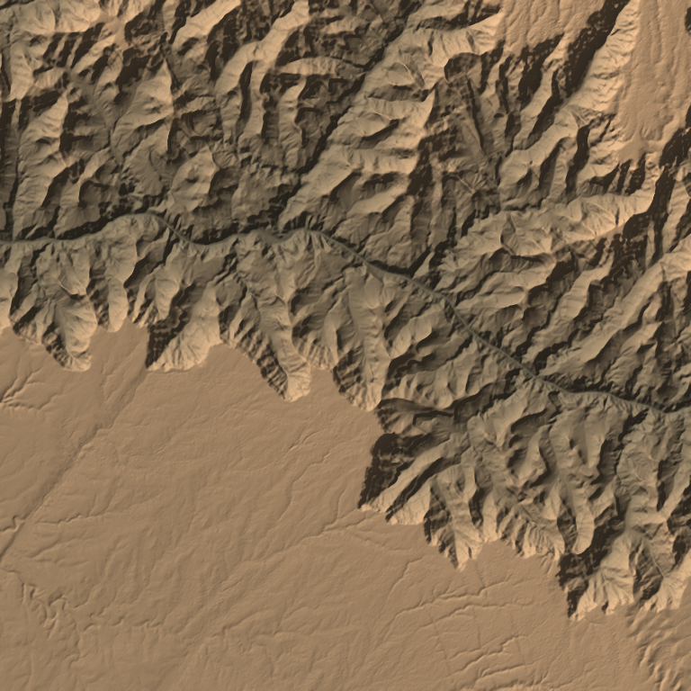
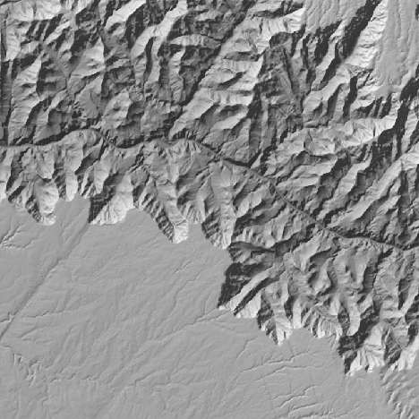

# #155: public elevation data into a terrain grid

Part of the real-terrain epic (#164).

`scripts/dem_fetch.py` downloads the elevation tiles that cover a square around a point, mosaics them, and resamples them onto an N×N grid in metres. pscat reads the grid with `readreals`.

```sh
FC_DEM_CACHE=/path/to/cache python3 -I scripts/dem_fetch.py \
    --center 36.065 -112.07 --size 24000 --n 768 \
    --out data/terrain/grand_canyon --preview renders/gc.png
```

**Outputs:**
- `OUT.bin`: N·N little-endian binary64 heights in metres, row 0 north, each row west to east. pscat reads it with `(OUT.bin) N N mul readreals`.
- `OUT.json`: source, tile URLs and their sha256, licence and attribution, vertical datum, centre, size, cell, projection and height range.

**Map coordinates** are x east, z north, in metres from the centre. Row 0 is the far (high z) row, as `MapGrid`'s rows run, so #156 and #157 can lay the grid straight onto `MapRect`.

**Projection:** each sample's latitude is `lat0 + z/R` and its longitude `lon0 + x/(R cos lat)`. Across 25 km that is within a few metres of UTM, well under one 30 m cell, and it needs no GIS libraries. The only dependencies are numpy and Pillow, which reads the GeoTIFFs through libtiff.

**Sources:**

| Key | Data | Licence | Notes |
|---|---|---|---|
| `cop30` (default) | Copernicus GLO-30 DSM, 1″ (about 30 m), worldwide | Free use and redistribution with attribution (in the `.json`) | About 40 MB a tile. Mosaics across tiles. A surface model, so trees and buildings are included. |
| `usgs13` | USGS 3DEP 1/3″ (about 10 m), US only | Public domain | About 420 MB a tile. The box must lie within one tile. |

**Where the data lives:**
- The downloaded tiles stay out of the repo, in `$FC_DEM_CACHE`, or `renders/dem-cache/` by default. Each tile has its own directory, and the files are treated as untrusted (run the script with `python3 -I`).
- The resampled grids are committed under `data/terrain/`, as a piece's input like any other asset. Renders then reproduce without the network. `grand_canyon.bin` is 768² cells (4.7 MB).

## First grid: the Grand Canyon

A box 24 km on a side around 36.065° N, 112.07° W. It covers Grand Canyon Village, the river from Granite Gorge to Phantom Ranch, the buttes, and the North Rim side. The data comes from four Copernicus tiles (the box crosses 36° N and 112° W), resampled at a 31.3 m cell. Heights run from 714 m (the Colorado) to 2520 m.

| Python preview (`--preview`) | Read by pscat (`spikes/dem_plan.ps`, 0.8 s) |
|---|---|
|  |  |

Both are lit from the north-west. No seams show where the tiles meet.

**Next:**
- #156: lay this grid onto the ground as the terrain itself, with the fractal filling in only below the cell size.
- #157: the map table at this resolution.
