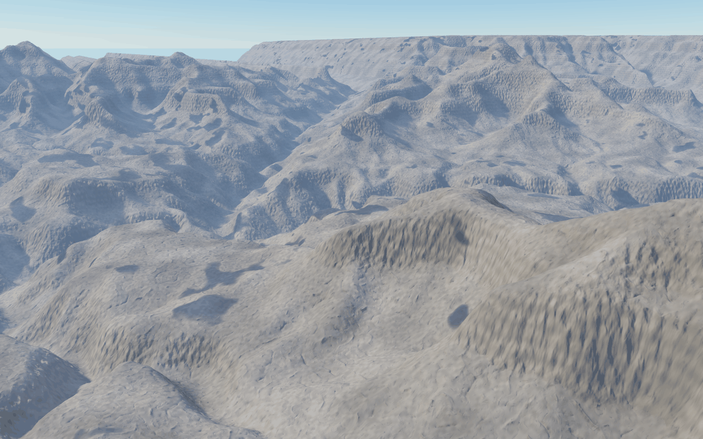

# #156 and #157: a real elevation grid as the ground

Part of the real-terrain epic (#164). `lib/fc_dem.ps` makes a grid from `scripts/dem_fetch.py` (#155) the terrain itself. Fractal detail is added only below the grid's cell.

`spikes/grand_canyon_dem.ps`:
- **Grid:** the Copernicus GLO-30 Grand Canyon grid, 768² cells of 31.3 m.
- **Camera:** Mather Point on the South Rim (36.0617° N, 112.1078° W), 15 m up, looking toward 36.125° N, 112.07° W.
- **Look:** the materials are still the mountains' rock, so the colours are not the canyon's. Its rock layers are #160.
- **Render:** 1280×800, 3×3 supersampled, 38 s through `kernelimage` on the test build.

## How it works

- **Loading:** `DemOn` loads `fc_dem.ps` at the top of `fc_terrain.ps`. It reads the grid with `readreals` and normalises it to 0..1 over `DemLo..DemHi`. It then sets `TerrH`/`TerrBase` (the relief, in units of `DemUnit` metres), `TerrScale` (1/(1.5 cells)), `TerrFn` 4, `TerrStep` and `ShadBias` as defaults. Everything computed from them when the file loads (`TerrTop`, the shadow bias) follows.
- **Height:** `fc-height-proc` (TerrFn 4) is a Catmull-Rom lookup over 4×4 cells, which passes through every cell's value, plus zero-mean erosion fBm at wavelengths from 1.5 cells down, `DemDetail` cells high. The fBm is only added where those octaves are over two pixels. Beyond the grid the edge cells carry on.
- **No warp, no massif, no erosion bake:** the ridgelines, rims and buttes are where the data has them.
- **March:** the terrain march stepped 0.42 × the height above the ground, which holds for slopes up to about 2.4. The grid's steepest cell is 3.5, so `TerrStep` is set from it: 0.25 here. Other pieces keep 0.42.

## Checks

- **Fidelity** (`spikes/dem_check.ps`): `fc-height-proc` at 300 random grid cells against the grid's own heights.
  - Without detail: max error 1.8e-12 m.
  - With all of it: max 3.1 m, mean 0.03 m, against a 31 m cell.
- **Compiled:** no interpreter fallbacks. A 1024² grid of the same box (23.5 m cells) renders the view in 44 s, 1280×800 at 3×. That covers #157's "a 1024² grid renders at preview speed".
- **Regress:** all 14 cases unchanged. `TerrStep` and `ShadBias` keep their old values when `DemOn` is false.

## Next

- #158: earth curvature. The North Rim is 15–20 km away, where the ground drops 20–30 m.
- #159: real viewpoints from latitude and longitude (`fc-dem-xz` is there), and a skyline overlay against a photo.
- #160: the canyon's rock layers by elevation.
