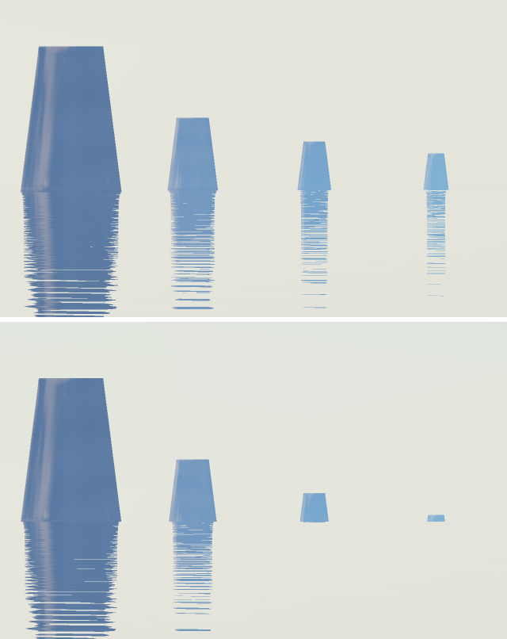
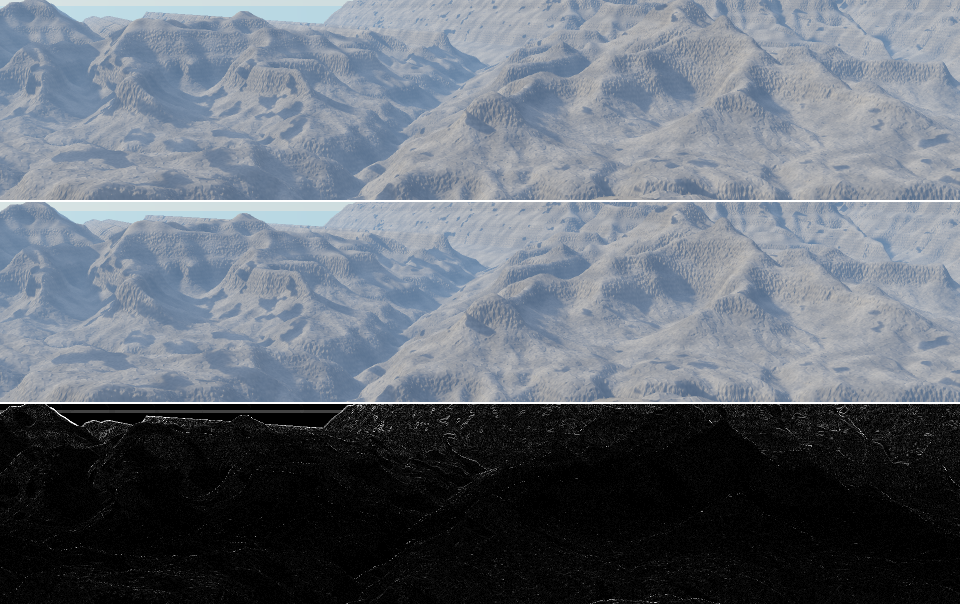

# Earth curvature (#158)

Part of the real-terrain epic #164. Over long sight lines the ground falls away below the camera's level. At distance d it drops by d²/(2R), and standard refraction takes back about 13% of that (k = 0.13), so the drop is d²/(2R'), with R' = R/(1 − k). That comes to 7 m at 10 km, 27 m at 20 km and 109 m at 40 km. Across San Francisco Bay or the Grand Canyon it is large enough to see.

## How it works

`Curve` true bends the rays instead of lowering the world. Seen from the camera the two are the same.

The ray's height at t is CamY + My·t + `CvB`·t². `CvB` = `CvA`·(Mx² + Mz²) is set per ray in `fc-landscape-pixel` (and in `fc_passes.ps`), with `CvA` = (1 − `CurveRefr`)/(2·`CurveR`/`CurveUnit`).

The ground and water keep their true heights. So the snow line, the coast's beach and wet bands, the sea-level tests and the coming rock strata (#160) need no change. A lowered world would have needed the drop added back at each of them.

These places now follow the bent ray:
- **The march and hit points:** the terrain march, the forest march and its hit points, the boulder step and the coast's step. `Ky` in `fc-terrain-shade` and the trees' `FcY` and `Fwy` carry the bend, so shadows and heights above the ground start from the real hit.
- **Early exits:** the "above the terrain and climbing" test uses the ray's local slope, My + 2·`CvB`·t.
- **Water planes** (`fc-water-plane-t`): the first root of CamY + My·t + `CvB`·t² = level. It returns nothing when the bent ray passes over the level, beyond the horizon. The sea's march bound (`fc_ocean.ps`) uses the same root.
- **Water shading:** Fresnel, the reflected ray and the sun glitter use the ray's slope where it meets the water (`AqMy`). Near the horizon that slope goes to 0, and that is where curvature shows most.
- **The reflected ray** bends too. It leaves the water point at the reflected slope (`CvB` is swapped and restored along with `Mx`, `My`, `Mz` and `CamY`). The wet sand's reflection does the same.
- **A miss:** the sky is looked up along the ray's heading where it leaves at `TMax`.
- **`LookAt`:** the pitch aims where the target appears.

Clouds, haze, sun shafts and the storm still see straight rays. Their heights are invented anyway, and over these distances the difference is small.

With `Curve` off, `CvA` and `CvB` are exactly 0. Every `+ 0·t²` returns the same bits, so `scripts/regress.sh` is all unchanged (14/14), and golden_coast renders byte-identical to main at the same speed.

## Checks

`spikes/curve_check.ps` sends rays through `fc-landscape-hit`, so the water plane and the march are both tested. It finds two things:
- the dip of the sea's horizon: the lowest ray that still meets the water;
- the lowest visible point of a wall standing out of open water.

The textbook values below were computed separately in Python on a sphere of radius R'. The dip is acos(R'/(R'+h)). The hidden height is the exact sphere value, which matches (d − √(2hR'))²/(2R') to these figures.

| Eye height | Wall at | Dip (spike) | Dip (textbook) | Hidden (spike) | Hidden (textbook) |
|---|---|---|---|---|---|
| 2 m | 20 km | 0.04235° | 0.04235° | 14.52 m | 14.53 m |
| 30 m | 30 km | 0.16400° | 0.16400° | 5.58 m | 5.58 m |
| 100 m | 60 km | 0.29943° | 0.29943° | 32.24 m | 32.24 m |

With `Curve` off, the water reaches level: the dip only reflects where `TMax` cuts the ray, and nothing is hidden. With `Ocean` true the results are the same, which checks the sea's march bound too.

`spikes/curve_islands.ps` is the known case: four islands, each 100 m high, 10, 20, 30 and 40 km out across open water. The view is through a 2° lens from 2 m above the sea. In the image below, the top half has `Curve` off and the bottom half has it on. The tops land within a pixel of the textbook in both:

| Island | Top row, off (predicted) | Top row, on (predicted) |
|---|---|---|
| 10 km | 58 (58.2) | 71 (70.7) |
| 20 km | 148 (148.1) | 174 (173.1) |
| 30 km | 178 (178.0) | 216 (215.6) |
| 40 km | 193 (193.0) | 243 (243.1) |

With curvature on, the 30 km island loses 41 m of its height and the 40 km island 82 m. Their reflections go with them.

Two things this spike ran into, both about the test rather than the curvature:
- **The march's ceiling.** `TerrTop` (1.25·`TerrH` + `TerrBase`) is where a climbing ray stops marching. With `TerrH` 10 and `TerrBase` -5 it cut every island off at 75 m, and the first comparison was off by up to 9 px until that was found.
- **The step.** The march's floor step, 0.2 + 0.004·t, is wider than a 70 m island at 40 km, so the spike caps it through the `fc-terrain-step` hook. Real terrain is far wider than its step.

## The Grand Canyon

`spikes/grand_canyon_dem.ps` (from Mather Point, looking north-north-east) with `Curve` off and on, and their difference. The skyline is 12 to 17 km out, and it drops by about a pixel at 960 px wide; it is the main thing that moves. Part of that skyline is not the North Rim. The 24 km grid ends about 12.4 km north of Mather, and between bearings of about −10° and 30° the skyline is the grid's edge carried on. The real North Rim, 16 to 18 km out, fills only bearings 40° to 70°. A wider grid fixes this (#159). Rendering takes 9 s either way (kernelimage, 960×600, 2×2).

Reproduce:

    printf '/Curve true def /CcH 0.2 def /CcD 2000 def\n(spikes/curve_check.ps) run\n' > /tmp/c.ps
    pscat --page 10x10 --png /tmp/c.png /tmp/c.ps
    scripts/render.sh spikes/curve_islands.ps
    scripts/render.sh -D Curve=false spikes/curve_islands.ps
