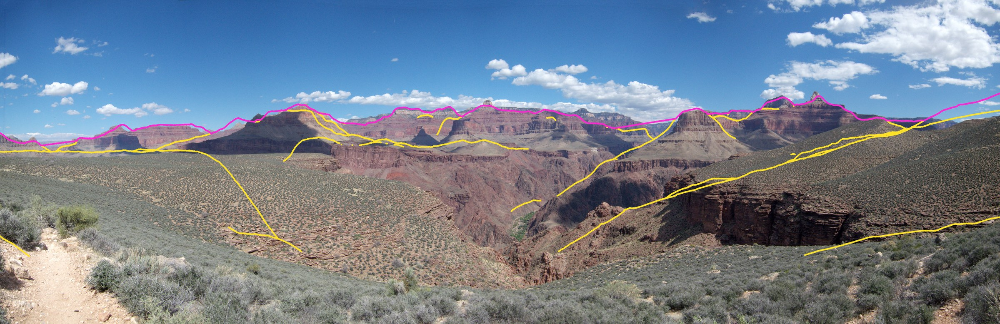
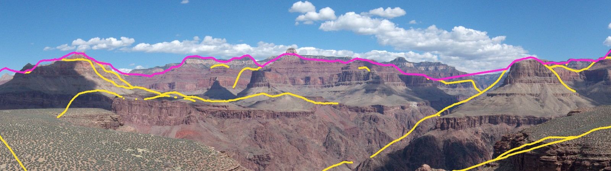
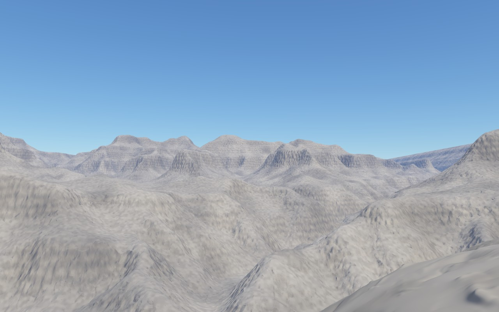

# A real viewpoint against a photo (#159)

Part of the real-terrain epic #164. This is the precision demo: the Grand Canyon grid (#155, #156), rendered by pscat from where a real photo was taken, with its ridgelines drawn on that photo.

The photo is "Grand Canyon National Park, Phantom Ranch As Seen From Tonto Trail 3225". It was taken on 31 March 2013 and is a public-domain work of the National Park Service (Grand Canyon NP's Flickr, via [Wikimedia Commons](https://commons.wikimedia.org/wiki/File:Grand_Canyon_National_Park,_Phantom_Ranch_As_Seen_From_Tonto_Trail_3225_-_Flickr_-_Grand_Canyon_NPS.jpg)). It is a stitched panorama, 6000×1946, spanning about 170° from the Tonto Trail looking north over Phantom Ranch. The skyline there is temples and buttes 3 to 10 km away, against blue sky.

How to read the overlay:
- **Magenta** is pscat's skyline: from depth passes of `spikes/tonto_phantom.ps`, with Earth curvature on, mapped into the photo.
- **Yellow** is pscat's silhouettes: ground at least 1.3 times nearer than the ground beside it, such as the Tonto Platform's edge against the far cliffs.

Across the whole width the rendered skyline lies a median 12 px from the photo's, which is 0.35°. 75% of it is within 24 px (0.7°). That is about the grid's own precision: one 31 m cell at 6 km is 0.3°. Closer up, in the centre:

The rendered view itself (64°, looking north). It still uses the mountains' material; the rock strata are #160:

## How it was fitted

`scripts/skyline_overlay.py fit` uses only the skyline:
- **The photo's skyline**, found by colour: sky is blue or white cloud, and rock is red.
- **The grid's horizon**, computed in Python straight from the grid: at each bearing, the highest elevation angle along the ray, less Earth's curvature with standard refraction (as #158).

The fit finds four things:
- the panorama's mapping: the bearing at its centre, pixels per degree, and the horizon row;
- a sine and a cosine term for the stitch's tilted horizon;
- the camera's position, which can move.

It leaves out bearings where the horizon is the grid's edge (the 24 km grid ends 9 km north of here) or nearer than 500 m.

The fit moved the camera 155 m south-west of the photo's geotag and 29 m above the grid's ground there. Geotags are often that far off, and at 2 km, 100 m is 3°. The panorama spans 170.8° at 35.1 px/degree. The fit is in `tonto-fit.json`.

`overlay` then reads pscat's own depth passes: five tiles of 64° from the fitted camera, at headings 275°, 320°, 5°, 50° and 95°. It turns each ridgeline pixel back into a bearing and elevation through `fc_render`'s pixel mapping and `fc-ray`, and maps those through the fitted panorama. The fit never sees the renderer. So when the overlay lands on the photo, the renderer, the grid, the projection and the new latitude-longitude settings all agree.

Reproduce:

    scripts/skyline_overlay.py fit PHOTO data/terrain/grand_canyon.json \
        --lat 36.090794 --lon -112.093312 --span-lo 100 --span-hi 260 --out fit.json
    for y in 275 320 5 50 95; do
        OUT=renders/d$y scripts/render.sh -D Yaw=$y -D Pitch=4 -D HFov=64 -D FrW=1600 -D FrH=1000 \
            --pass depth spikes/tonto_phantom.ps
        cp renders/d$y/tonto_phantom-depth.png d$y.png
    done
    scripts/skyline_overlay.py overlay PHOTO fit.json out.png \
        d275.png:275:4:64 d320.png:320:4:64 d5.png:5:4:64 d50.png:50:4:64 d95.png:95:4:64

## The settings it added

- `StandLL` [lat lon] or [lat lon m above ground] stands the camera there.
- `LookLL` [lat lon] or [lat lon elevation m] aims it.
- `FocalMM` and `SensorMM` set `HFov` from a real lens. For example, a Nikon D7000 at 70 mm (sensor 23.6 mm wide) gives 19.14°.

All three convert through the grid's own projection, before the libraries read `StandAt`, `LookAt` and `HFov`. They were checked against hand-computed values.

## What didn't work, and why

- **The rim view from Mather Point** (a public-domain photo of the Mather Point overlook, 12 February 2011). It failed for three reasons:
  - From the South Rim the North Rim skyline is nearly flat: 4 px of relief across 1200. A flat skyline can't fix the heading.
  - Between bearings −10° and 30° the 24 km grid ends before the North Rim, so the rendered skyline there is the grid's edge.
  - The overlook in the foreground is finer than the 31 m cells, and Copernicus is a surface model, so the rim's trees stand as a dome at eye height.
- **Matching shading instead of the skyline.** The renders use the mountains' material, so their shading doesn't resemble a photo of red rock. Cross-correlation of the shading peaked at 0.2 to 0.3 and gave impossible tilts.
- **A single frame with a known lens**: "Winter Fog From Tonto Platform", a Nikon D7000 at 70 mm. The far skyline was in fog, and the clear silhouettes are 1 to 3 km away, where a geotag error of 100 m moves them by degrees. The fit didn't converge from the geotag.

The lesson for future overlays: choose a photo whose skyline has real relief, lies inside the grid and is at least a few kilometres off. A wider grid (#162) would also let rim views reach the North Rim.
