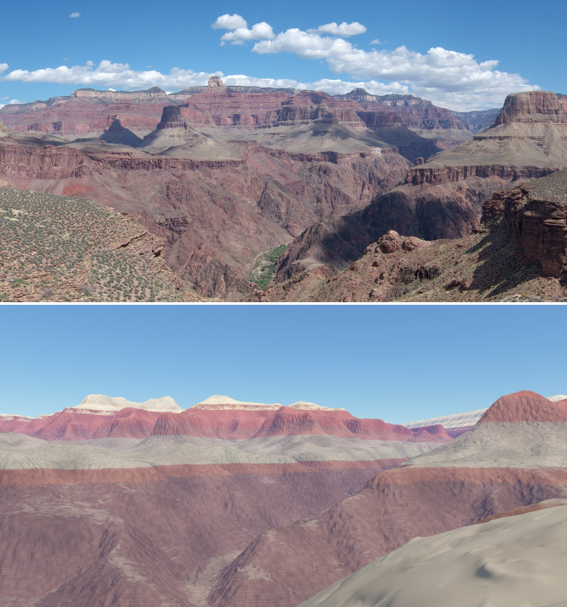
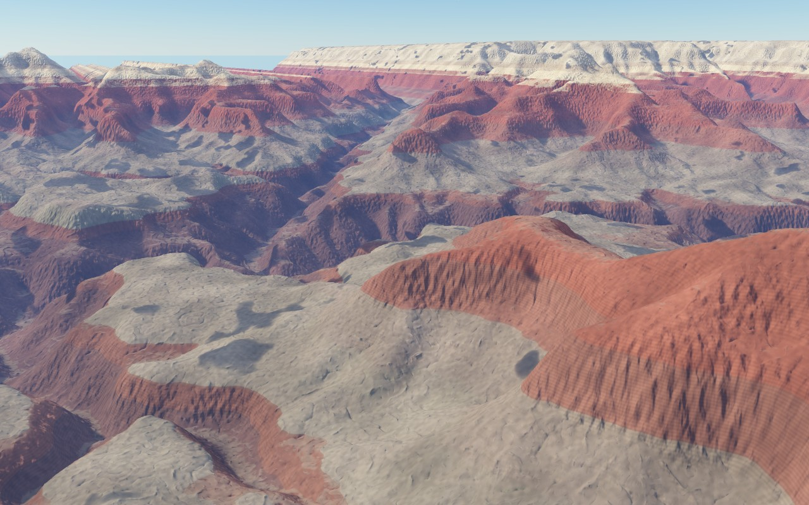

# Rock strata by elevation (#160)

Part of the real-terrain epic #164. Grand Canyon rock reads by its horizontal beds. `lib/fc_layers.ps` colours the ground from a table of beds, and `data/terrain/grand_canyon_layers.ps` is the canyon's table.

The top half is a crop of the public-domain NPS panorama from #159, centred on bearing 5°. The bottom half is `spikes/tonto_phantom.ps` from the camera #159 fitted, at the same heading and framing. The beds line up:
- the pale Kaibab and Coconino capping the North Rim and the temples;
- the red Supai and Hermit, and the Redwall below them;
- the grey-green Tonto Platform (Bright Angel Shale) the camera stands on;
- the dark Tapeats lip of the inner gorge;
- the Vishnu Schist below it.

The colours were picked by eye against this photo.

From Mather Point, looking north-north-east (`spikes/grand_canyon_dem.ps`):

## The table

These are the bases at Mather Point, in metres above sea level. They follow the standard section along the Bright Angel and South Kaibab trails, and the thicknesses are approximate. Individual beds vary by tens of metres across the park.

| Bed | Base (m) | Weathers as | Thickness (m) |
|---|---|---|---|
| Kaibab Limestone | 2060 | cliff | ~90 below the rim |
| Toroweap Formation | 1985 | ledges | ~75 |
| Coconino Sandstone | 1885 | cliff | ~100 |
| Hermit Formation | 1795 | slope | ~90 |
| Supai Group | 1505 | ledges and slopes | ~290 |
| Redwall Limestone | 1355 | cliff | ~150 |
| Muav Limestone | 1235 | ledges | ~120 |
| Bright Angel Shale | 1125 | slope (the Tonto Platform) | ~110 |
| Tapeats Sandstone | 1065 | cliff | ~60 |
| Vishnu Schist | (basement) | cliff | down to the river |

The beds are taken as level. The regional rise toward the Kaibab uplift to the north is real, but a rise of 15 m per km put Tapeats under the Tonto Trail camera, where the photo shows Bright Angel slope. With no rise, the camera's ground (1161 m) is Bright Angel Shale, as the photo shows. `LayersDip` takes a better figure when one is found.

## How it colours

The hook chains onto `fc-terrain-material`. It takes the point's true height in metres; the rays bend for curvature (#158) rather than the ground dropping, so the height is true. It removes the dip, adds a fractal wobble of `LayersWobble` metres so contacts aren't ruled lines, and finds the bed. Then:
- **Contacts:** neighbouring beds blend halfway at each contact, over `LayersBlend` metres either side.
- **Bedding:** stripes `LayersBed` metres apart brighten and darken steep faces.
- **Talus:** on a slope-forming bed, gentler ground takes the colour of the nearest cliff-former above, as talus does.
- **Soil:** near-flat ground (benches, plateaus, the Tonto Platform) takes on `LayersSoilCol`.

The terrain's own patches and mottling (`Kpat`) still multiply the result.

## Kernelimage

The first version branched with colours on the stack (`... { mix3v } if`). Kernelimage retires any branch whose stack entries differ between its arms, and then the whole image ran in the interpreter: a 26 s view took more than 10 minutes. Every mix is now unconditional, with its weight set to 0 where it doesn't apply, and each branch leaves only a number. The bed is found by counting the bases above the point, not by a loop that exits. The two views above take 22 to 24 s at 1280 px with 2×2 supersampling.

## Next

- The rim plateaus need forest and soil from land cover (#161).
- The Grand Canyon piece (#162) will art-direct the light and palette. The render's reds still read a little pink against the photo's maroon.
- Cliff-formers would stand sharper with a finer grid. 31 m cells round the Redwall's 150 m face into a steep slope.
